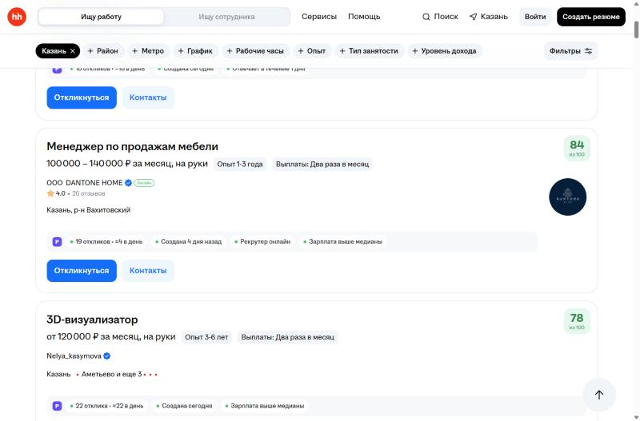
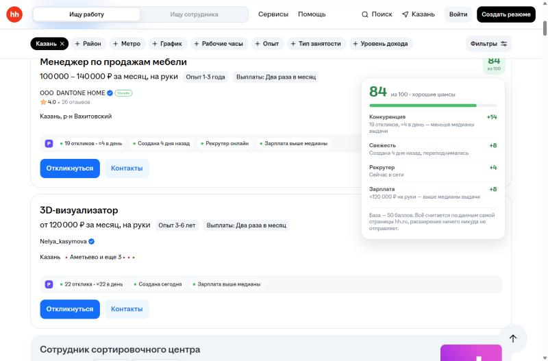
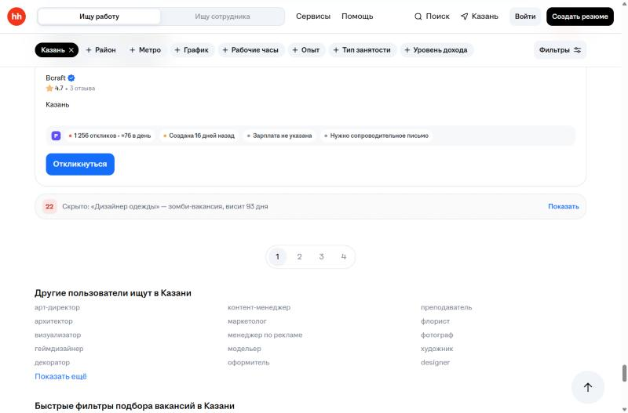

# ХаХантер

> Независимый проект. Не связан с HeadHunter (hh.ru) и не одобрен им.

Расширение для браузера, которое показывает на hh.ru то, что сайт знает о вакансии, но не выводит на страницу, и сводит это в одну понятную оценку шансов от 0 до 100.



## Зачем

На карточке hh.ru все вакансии выглядят одинаково. При этом в данные страницы уже зашито:

- сколько людей откликнулось (`totalResponsesCount`);
- когда вакансия создана на самом деле (`creationTime`), а не когда её последний раз подняли (`publicationTime`);
- есть ли тестовое задание (`userTestPresent`) и обязательно ли письмо (`@responseLetterRequired`);
- в сети ли рекрутер прямо сейчас (`employerManager.latestActivity`);
- как быстро работодатель отвечает (метки `employer-reply-speed-*`).

Замер на реальной выдаче «дизайнер», Казань, 21.11.2026, 50 вакансий: у 20 между созданием и последним поднятием прошло больше недели, у 4 — больше месяца (рекорд — 206 дней). Медиана — 110 откликов на вакансию, максимум — 2 076.

## Что делает

- **Оценка на каждой карточке** — 0–100, зелёная от 75, жёлтая от 45, красная ниже.
- **Расшифровка по наведению** — из чего сложилась оценка, с плюсами и минусами по каждому фактору.
- **Полоса с данными** — отклики и их темп, настоящий возраст, скорость ответа, зарплата относительно выдачи.
- **Фильтры** — скрыть зомби-вакансии, вакансии с больше чем 100 откликами, без зарплаты, с тестовым, с рекрутером не в сети. Скрытые не пропадают, а сворачиваются в строку с причиной и кнопкой «Показать».
- **Без рекламы hh** — по умолчанию скрывает рекламные баннеры hh (места Adfox: главная, выдача, страница вакансии) и блок «Курсы по профессии» с промокодами. Ничего не удаляет, только прячет; выключается в окне настроек.
- **Тёмная тема для самого hh.ru** — у сайта hh есть ночная тема, но переключателя для пользователей нет (официально тёмная тема вышла только в приложении). Кнопка «☾ Тёмная тема» в панели или выбор в окне настроек (как на сайте / тёмная / как в системе) включает её; тема ставится в самом начале загрузки страницы, без белой вспышки.
- **Тёмная тема** — расширение следует теме hh.ru: включили на сайте тёмную, и панель, оценки и расшифровка переключаются вместе с ним, без перезагрузки. Окно настроек берёт тему, которую последней видел на hh, иначе — системную.
- **Порог «До N откликов»** — число меняется прямо в кнопке фильтра (и в окне настроек).
- **Важность факторов** — ползунки: каждый фактор можно отключить или сделать важнее, оценка пересчитывается сразу.
- **Настройки по клику на значок расширения** — те же фильтры, сортировка и важность факторов; применяются на открытых страницах без перезагрузки.
- **Страница отдельной вакансии** — та же оценка. hh не отдаёт там число откликов и дату создания, поэтому расширение запоминает данные вакансий, которые вы видели в выдаче (до 400 штук, 7 дней), и показывает оценку по ним с пометкой, на какое время она посчитана. Если вакансию открыли по прямой ссылке, не заходя через выдачу, оценки не будет.
- **Сортировка «Сначала лучшие»** — без перестановки элементов страницы, через CSS `order`, чтобы не ломать React-вёрстку hh.





## Как считается оценка

База 50 баллов, дальше плюсы и минусы:

| Фактор | Баллы |
|---|---|
| Отклики: до 20 / 50 / 100 / 250 / 500 / больше | +14 / +8 / +2 / −6 / −12 / −20 |
| Возраст: до 3 / 7 / 14 / 30 / 60 дней / старше | +12 / +8 / +3 / 0 / −8 / −14 |
| Зомби-вакансия (старше 30 дней и переподнималась) | ещё −4 |
| Метка hh «Отвечает в течение 1 дня» / «3 дней» / другая | +8 / +6 / +3 |
| Рекрутер в сети | +4 |
| Зарплата выше медианы выдачи на 15 % / на уровне / указана без сравнения / ниже / не указана | +8 / +4 / +4 / 0 / −4 |
| Тестовое задание | −6 |
| Обязательное сопроводительное письмо | −2 |

Зарплата «до вычета налогов» переводится в «на руки» по 13 %. Сравнение — только для рублёвых месячных зарплат и только если на странице их хотя бы пять. Веса подобраны вручную и будут уточняться.

## Приватность

Расширение ничего никуда не отправляет и не делает своих запросов. Оно читает данные, которые hh.ru уже прислал в браузер: при открытии страницы — из `#HH-Lux-InitialState`, при листании и смене фильтров — копию ответа hh со своего же домена. Хранит в браузере (`chrome.storage.local`) только ваши настройки и краткую копию данных вакансий из выдачи за последние 7 дней для страницы отдельной вакансии.

## Установка

**Chrome, Яндекс Браузер, Edge, Opera, Brave**

1. Скачать архив из релиза и распаковать (или взять папку `extension/` из репозитория).
2. Открыть `chrome://extensions` и включить «Режим разработчика».
3. «Загрузить распакованное расширение» → выбрать папку `extension`.

**Firefox 128+** — `about:debugging` → «Этот Firefox» → «Загрузить временное дополнение» → `extension/manifest.json`. Временное дополнение удаляется при перезапуске браузера; для постоянной установки сборку нужно подписать в Mozilla.

## Устройство

```
extension/
  manifest.json      Manifest V3, один файл для Chrome и Firefox
  src/theme.js       тёмная тема hh.ru по настройке (document_start)
  src/noads.js/.css  скрытие рекламы hh (document_start)
  src/hook.js        контекст страницы: копия ответов hh при листании → postMessage
  src/score.js       расчёт оценки, чистые функции без DOM
  src/content.js     встраивание интерфейса, фильтры, сортировка, расшифровка
  src/styles.css     стили с префиксом rv-
  popup/             окно настроек по клику на значок расширения
tests/
  score.test.js      тесты расчёта (node --test)
  fixtures/          12 вакансий из реальной выдачи
```

Тесты: `npm test` (нужен Node.js 18+).

## Ограничения

- Поля hh.ru внутренние и нигде не описаны. Если hh их переименует, расширение просто перестанет показывать оценку и не сломает страницу.
- На странице отдельной вакансии оценка зависит от того, видели ли вы её в выдаче (см. выше); данные об откликах там могут быть старше, чем в выдаче.
- Рейтинг работодателя не делали: у работодателей на странице выдачи нет различающихся данных (флаги проверки одинаковы у всех, у работодателя обычно одна вакансия на выдачу).
- Оценка — подсказка, а не прогноз: она не знает, насколько ваше резюме подходит под вакансию.

## Лицензия

MIT
